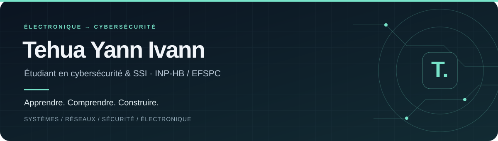

  

  <a href="https://16blo.github.io/portfolio/"><strong>Découvrir mon portfolio ↗</strong></a>
  &nbsp; · &nbsp;
  <a href="https://www.linkedin.com/in/yann-ivann-tehua/">LinkedIn</a>
  &nbsp; · &nbsp;
  <a href="#mes-projets">Mes projets</a>

## Bonjour, moi c’est Yann

Étudiant en **Licence professionnelle Cybersécurité et Sécurité des Systèmes d’Information à l’INP-HB / EFSPC**, je construis mes bases en administration système, réseaux et sécurité.

Mon parcours a commencé par un **BTS Systèmes électroniques et informatiques à l’ISTCI**, puis un stage en maintenance électronique chez **Lumos CI**, autour des batteries et des kits solaires autonomes. Cette expérience m’a donné le goût du diagnostic : observer, comprendre le fonctionnement, tester et vérifier.

Aujourd’hui, mes projets sont des terrains d’apprentissage. Je cherche à comprendre ce que je mets en place et à documenter ma progression.

## Ce que j’explore

| Systèmes & réseaux | Développement web | Électronique |
| :--- | :--- | :--- |
| Linux, permissions et services | Bases HTML, CSS et langage C | Diagnostic et maintenance |
| Proxmox VE et virtualisation | PHP / PDO et MariaDB en laboratoire | Arduino et Proteus |
| VLAN et Packet Tracer | Authentification et requêtes paramétrées | Du schéma au prototype |

**Mon objectif :** relier le matériel, les systèmes et les réseaux pour mieux comprendre leur sécurité.

## Mes projets

### [Portfolio personnel ↗](https://16blo.github.io/portfolio/)

Mon parcours, mes projets et mes certifications dans une interface responsive, avec un bandeau animé et des thèmes clair et sombre.

**React · TypeScript · Vite**  
[Consulter le code source](https://github.com/16blo/portfolio)

### [Portail de demande d’acte de naissance ↗](https://github.com/16blo/portail-naissance)

Un travail pratique réalisé dans le cadre de ma formation CSSI pour explorer le développement d’une application web.

### [Laboratoires & travaux pratiques ↗](https://16blo.github.io/portfolio/#projets)

Virtualisation et segmentation réseau avec Proxmox et VLAN, administration Linux, authentification web avec Nginx / PHP / MariaDB et expérimentations électroniques.

Les fiches du portfolio présentent le contexte, les réalisations et les apprentissages de chaque projet.

## En ce moment

- Consolider mes bases **Linux, réseaux et cybersécurité**.
- Progresser en **développement web** avec des applications concrètes.
- Enrichir la documentation de mes projets et suivre mes formations.

Retrouve mes formations **OPSWAT Academy, Cisco Networking Academy et LinkedIn Learning** dans la [rubrique certifications](https://16blo.github.io/portfolio/#certifications).

---

  <strong>De la curiosité, de la pratique, et la suite à construire.</strong> 
  Ouvert aux échanges et aux projets d’apprentissage en systèmes, réseaux et électronique.

